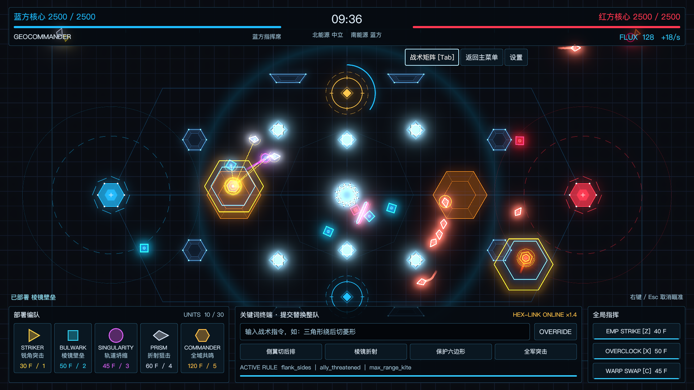
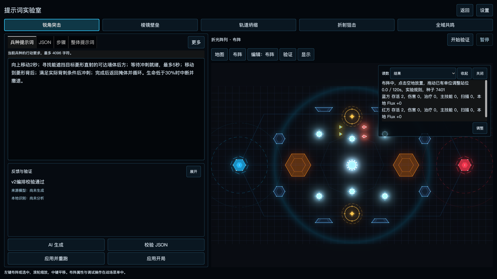
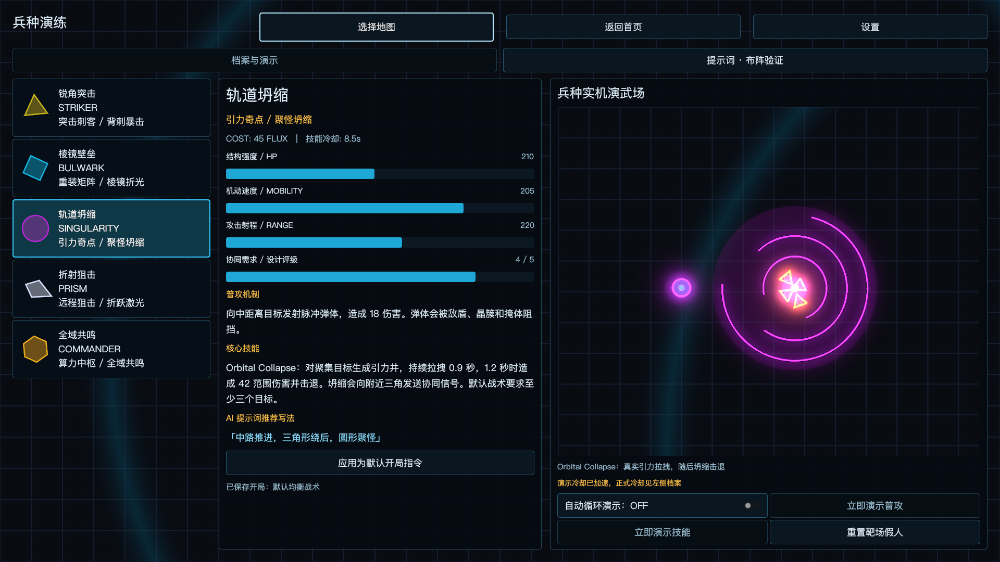
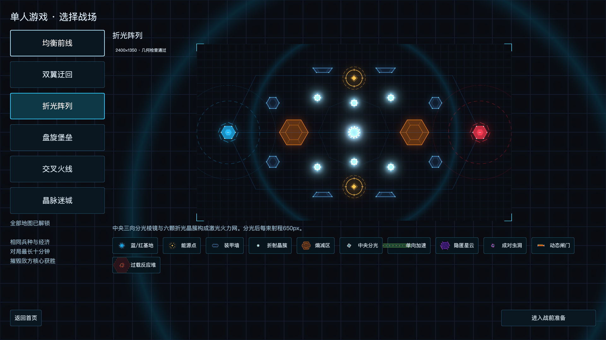

# GeoCommander · 几何最高指挥官

用部署和战术指令指挥五种几何兵种，争夺能源，摧毁敌方核心。

GeoCommander 是一个基于 **Godot 4.7.2 / GDScript** 的原生桌面战术游戏。单位自主战斗，你负责阵容、战术与全局技能；也可以在提示词实验室中，把自然语言转成可检查、可编辑、可回放的行动方案。

**单人对局可离线运行。AI 编译为可选功能，需自行配置 OpenAI 兼容接口。**

[快速启动](#快速启动) · [实机截图](docs/screenshots/README.md) · [完整操作手册](docs/game-guide.md) · [AI 配置指南](docs/ai-laboratory.md)



*折光阵列中的真实单人对局。图中部署经过资源扣除，单位按正式规则移动、攻击和施放技能。*

## 可以体验什么

- **五兵种协同**：冲刺绕后、护盾反射、引力聚怪、激光折射、治疗与扫描。红蓝阵营拥有相同的兵种体系。
- **六张战术地图**：预览与实战共用地图数据，包含墙体、晶簇、加速轨、星云、虫洞、闸门和反应堆等不同组合。
- **两种指挥方式**：战中用中英文关键词调整整队战术；战前在实验室中编排单兵种的方向、时间、路径、掩体和技能。
- **可观察的验证场**：自由布阵、同种子默认战术对照、实际伤害与治疗统计、步骤读数、暂停和逐帧调试。
- **纯程序化视觉**：几何、shader 与 HDR 发光构成战场，中文使用系统字体。全局字号支持 100% 至 180%，并提供低动效和等比全屏。

## 提示词实验室

进入「兵种演练 → 提示词 · 布阵验证」，为各兵种保留独立提示词、JSON 和开局配置，也可填写共享的整体提示词。

**编辑提示词 → AI 生成 → 本地校验 → 检查步骤 → 应用并重跑 → 明确应用为开局**



*此图载入内置三角编排示例并通过本地校验，未发起模型请求。完整画廊另有步骤编辑与运行读数。*

例如，可以将下面的意图拆成持续执行的步骤：

> 向上移动 2 秒；寻找能遮挡目标菱形直射的可达墙体后方；等待冲刺就绪，最多 5 秒；移动到菱形背后；满足实际背刺条件后冲刺；完成后返回掩体并循环。生命低于 30% 时中断并撤退。

模型输出须通过字段、能力和地图校验，再由游戏执行。无路可走、目标失效或技能条件不满足时会显示原因；支持的表达边界见[精细战术编排](docs/tactic-plan.md)。截图展示编辑与短时执行，不代表这条方案在所有阵容下都能完成循环。

无需 API Key 也能使用内置示例、手动编辑 JSON 和运行验证。启用 AI 时，在「设置 → LLM」配置 Base URL、Key 和模型，测试连接后再生成。Key 仅保留本次运行；提示词与实验方案保存在本机。详见 [API 与实验室指南](docs/ai-laboratory.md)。

## 五种兵种，从演练开始

兵种演练使用真实战斗实现，可以手动触发普攻、技能或自动循环，查看生命、射程、冷却与协同效果。



*圆形的引力聚怪演示。演武刷新冷却与站位，正式对局使用各兵种原始冷却。*

| 兵种 | 定位 | 关键能力 |
|---|---|---|
| 三角 · 锐角突击 | 近战突袭 | 蓄力冲刺、穿刺与背刺 |
| 方形 · 棱镜壁垒 | 前线保护 | 友军可穿越的护盾、激光反射 |
| 圆形 · 轨道坍缩 | 聚怪控制 | 脉冲弹体、引力拉拽与坍缩 |
| 菱形 · 折射狙击 | 远程输出 | 风筝、蓄力激光与最多两次反射 |
| 六边形 · 全域共鸣 | 支援指挥 | 治疗、冷却恢复加速与独立扫描，无直接普攻 |

## 六张地图

六图全部解锁，使用相同的兵种、经济与胜负规则。点击地图名称查看对应的实机选择界面。

| 地图 | 地形与机关 | 战术重点 |
|---|---|---|
| [均衡前线](docs/screenshots/map-balanced.png) | 三路防线、动态闸门、隐匿星云 | 入门与阵容协同 |
| [双翼迂回](docs/screenshots/map-flanks.png) | 南北加速轨、侧翼星云 | 快速推进与包抄 |
| [折光阵列](docs/screenshots/map-refraction.png) | 中央分光棱镜、六处晶簇 | 折射与远程协同 |
| [盘旋堡垒](docs/screenshots/map-spiral_fortress.png) | S 型墙体、一对虫洞 | 绕行与转移 |
| [交叉火线](docs/screenshots/map-crossfire.png) | X 型走廊、两对虫洞、闸门 | 多入口交战 |
| [晶脉迷城](docs/screenshots/map-crystal_maze.png) | 过载反应堆、Flux 拾取物、星云 | 危险区撤离与资源争夺 |



详细行为与提示词写法见[地图与交互地形](docs/map-overhaul.md)。

## 快速启动

当前已在 **macOS / Apple Silicon / Metal** 验证。项目使用 **Godot 4.7.2 Stable 标准版**，不需要 .NET；其他平台尚未完成实机验收，当前不提供签名安装包。

1. 克隆项目：

   ```sh
   git clone https://github.com/superyy-dreaming/GeoCommander-.git
   cd GeoCommander-
   ```

2. 使用 Godot 4.7.2 项目管理器导入根目录的 `project.godot`，完成首次导入后按 `F5` 运行项目。

   macOS 也可通过启动脚本指定自己的引擎：

   ```sh
   GEO_GODOT="/Applications/Godot.app/Contents/MacOS/Godot" ./run.command --headless --import
   GEO_GODOT="/Applications/Godot.app/Contents/MacOS/Godot" ./run.command
   ```

   `run.command` 不会安装引擎。未指定 `GEO_GODOT` 时，它会查找本机隔离目录 `~/.local/share/geocommander/tools/4.7.2/Godot.app`。

3. 首页选择「单人游戏 → 地图 → 进入战前准备」，编辑矩阵或直接开始。想先了解单位，可进入「兵种演练」。

最低窗口 **1280×720**，推荐 **1920×1080** 查看完整工具区。使用 Forward+、2D HDR 与 4× MSAA；首次着色器编译可能较慢。

## 一局怎么玩

初始阵容免费，双方各有九个单位和 180 Flux。基础收入每秒 12 Flux，占领能源棱镜可增加收入。每方上限 30 单位，其中六边形最多 2 个。

单位自动选敌、移动和战斗。你可以持续部署，并使用 EMP、超频区和拓扑转移改变局部战况。一局最长十分钟，摧毁敌方基地立即获胜；超时比较基地生命百分比，相同则平局。

| 操作 | 快捷键 |
|---|---|
| 按三角、方形、圆形、菱形、六边形顺序部署 | `1` / `2` / `3` / `4` / `5` |
| 移动镜头 / 缩放 | `WASD` 或方向键 / 滚轮 |
| EMP / 超频 / 拓扑转移 | `Z` / `X` / `C`，再点击战场 |
| 打开战术矩阵 | `Tab`（未编辑文字时） |
| 取消技能瞄准 | 右键或 `Esc` |

战中终端支持「三角形绕后切菱形」「保护六边形」「分推，晶簇折射」等关键词。提交会**替换整队战术**；实验室的「应用开局」则只替换当前兵种。完整规则和快捷键见[操作手册](docs/game-guide.md)。

## 文档与验证

| 想了解什么 | 入口 |
|---|---|
| 首页、六图、演练、设置、战斗与实验室截图 | [14 张原生实机截图](docs/screenshots/README.md) |
| 全部操作、资源规则、设置与验证命令 | [操作与开发手册](docs/game-guide.md) |
| LLM 配置、提示词与实验保存 | [AI 提示词实验室](docs/ai-laboratory.md) |
| 行动步骤、路径、掩体、条件与中断 | [精细战术编排](docs/tactic-plan.md) |
| 六图机关、隐匿感知与数据迁移 | [地图与地形系统](docs/map-overhaul.md) |
| 已有模型生成与行为回放证据 | [真实模型验证](docs/real-llm-verification.md) |
| 地图与镜头修复验证记录 | [地图验证](docs/map-overhaul-verification.md) · [镜头稳定性](docs/camera-jitter-verification.md) |

基础检查（使用启动脚本时需先配置引擎路径）：

```sh
./run.command --headless --import
./run.command --headless --scene res://tests/check_scripts.tscn
./run.command --headless --scene res://tests/test_runner.tscn
./run.command --headless --scene res://tests/map_overhaul_runner.tscn
```

主要源码：`scripts/core/` 为战斗、地图和战术执行；`scripts/units/` 为五兵种；`scripts/lab/` 为实验上下文；`scripts/ui/` 为原生界面。各场景共用 `CombatContext` 与 `MapCatalog`。

## 当前范围

当前是可本机运行的单人 MVP。多人游戏仅有菜单，尚无联网对战；不含音频、战局存档或内置 LLM 账号。实验文件与游戏设置可保存，默认开局指令只在本次运行内生效。

本页图片均来自当前项目原生运行画面，拍摄于 **2026-10-25**，经过 HDR 线性颜色到 sRGB 的显示编码，没有重绘界面。文档图片位于 `docs/screenshots/`，不作为游戏素材加载；引擎缓存、个人配置、API Key 和本地测试原始帧不会提交到仓库。
