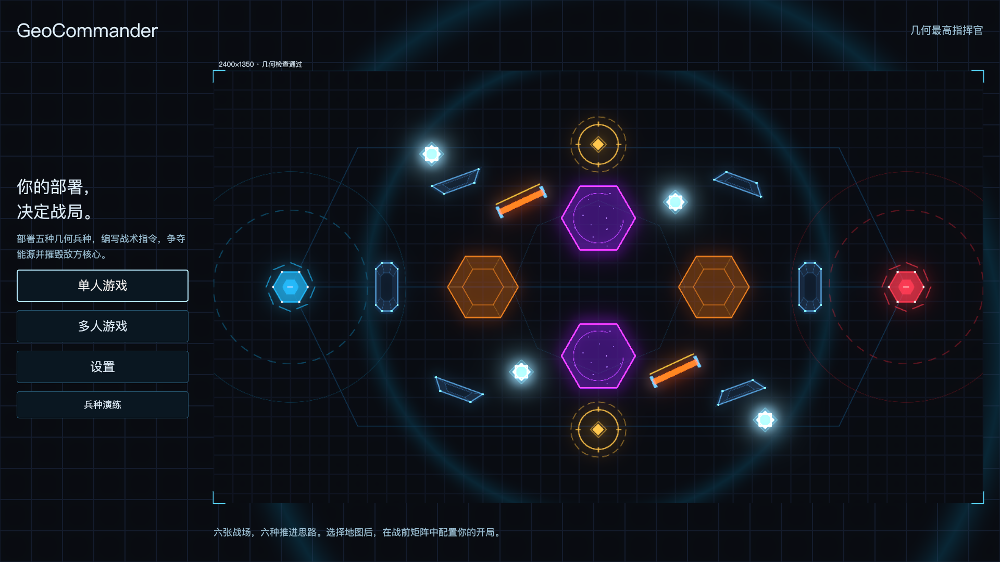
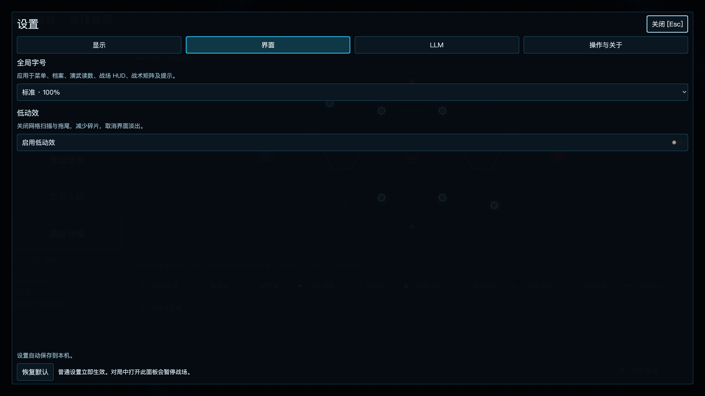
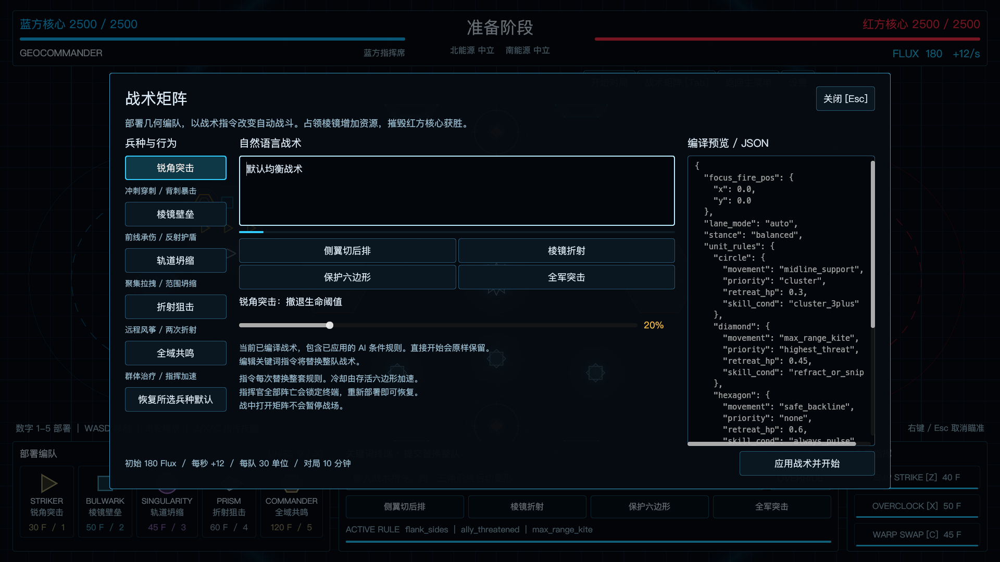
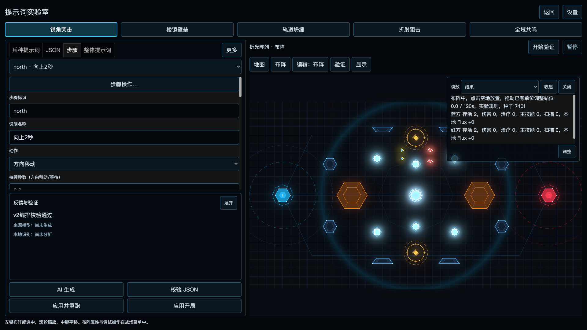
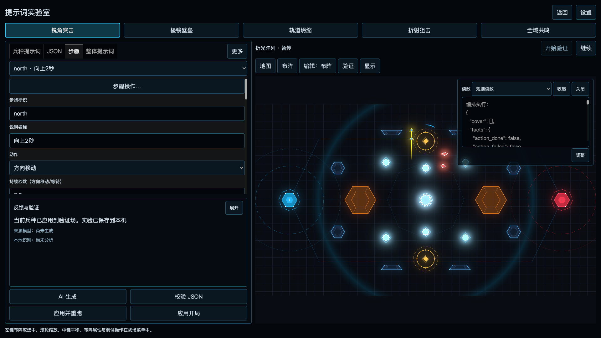
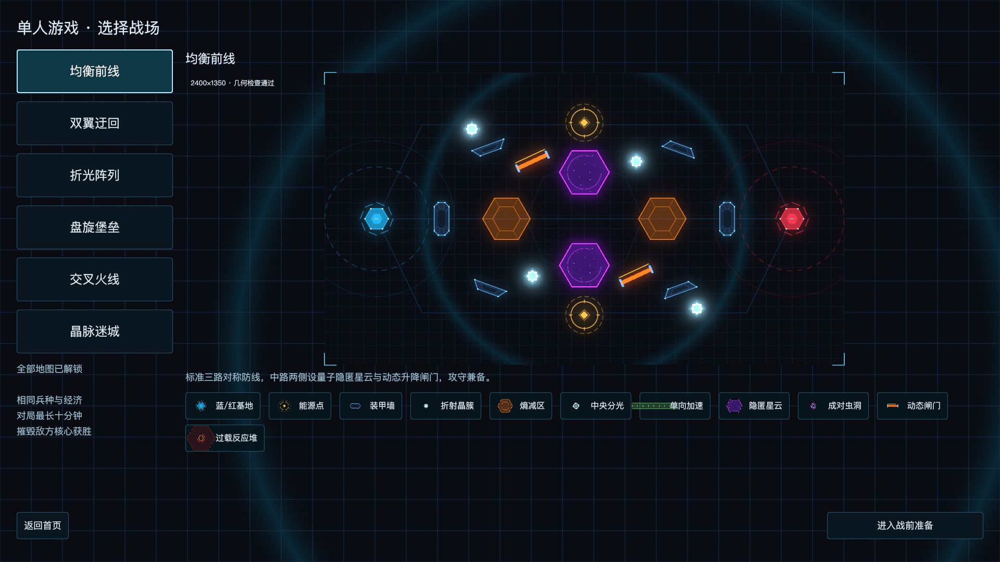
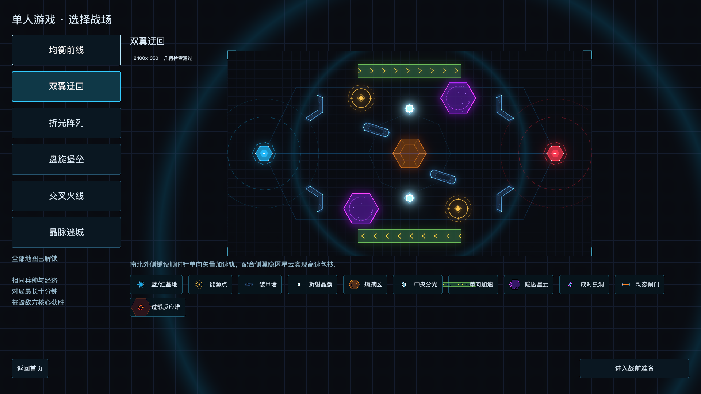
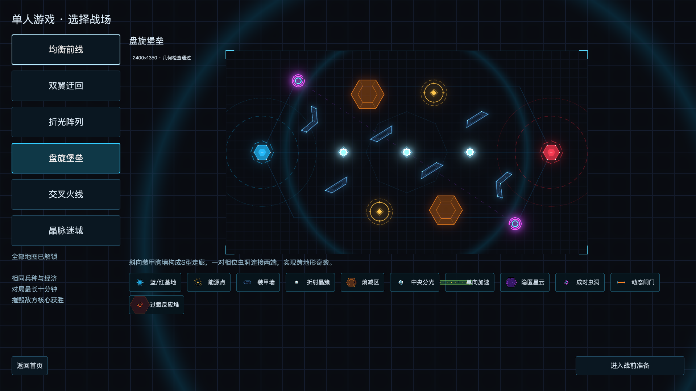
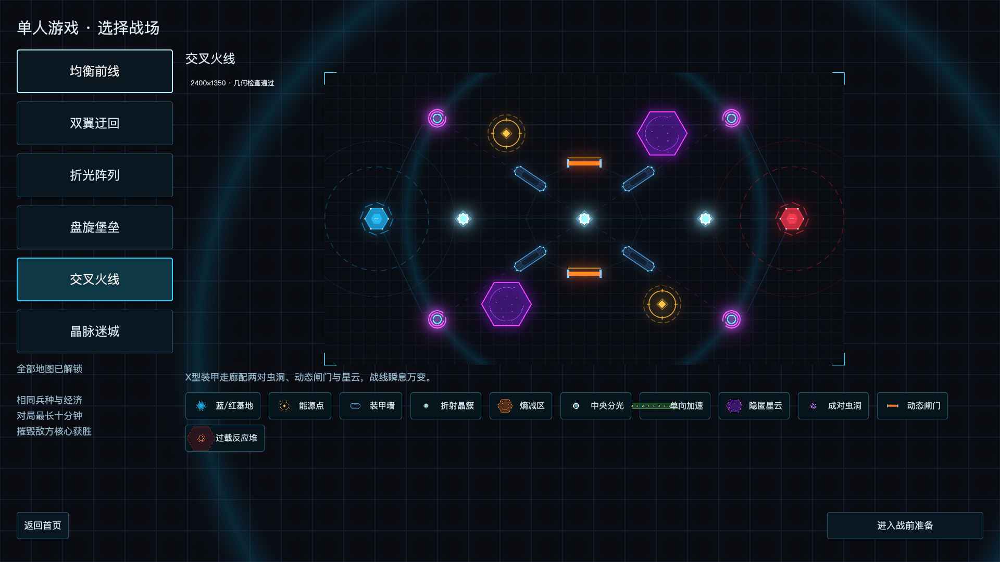
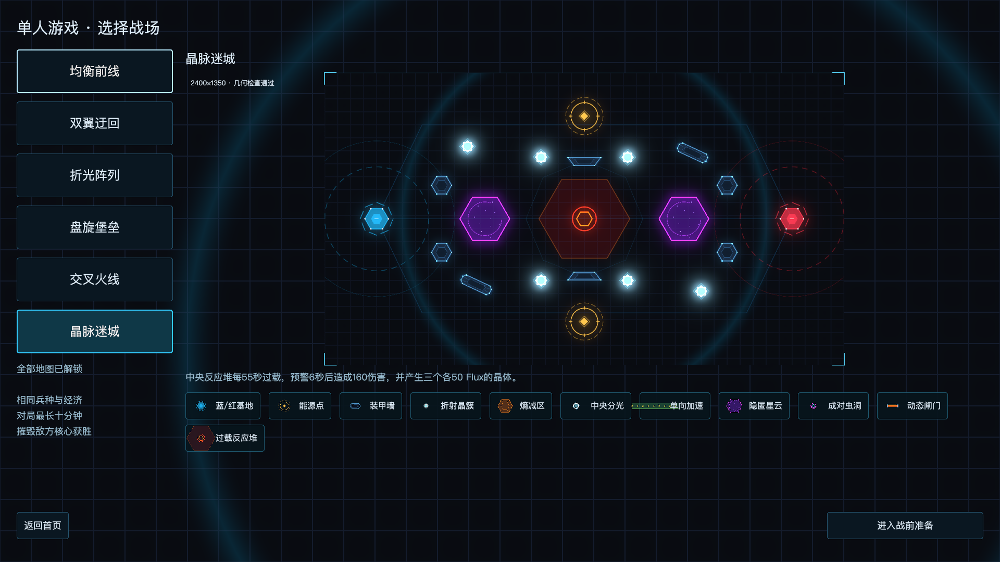

# GeoCommander 实机截图

[返回项目首页](../../README.md) · [操作手册](../game-guide.md)

以下 14 张图片拍摄于 2026-10-25，来自 Godot 4.7.2 原生窗口，使用 Apple Silicon / Metal、Forward+、2D HDR、1920×1080 与 100% 字号。拍摄设备的屏幕缩放为 Retina 2×，图片保留游戏帧缓冲的 1920×1080 分辨率。

图片从真实 HDR 帧缓冲编码为 sRGB PNG，没有重绘、添加界面元素或后期合成。点击图片或标题可查看原图。它们用于说明当前功能，不是性能或完整行为验收报告。

## 首页与设置

首页进入单人地图、兵种演练和设置。截图选择“界面”页，展示字号与低动效选项；发光强度位于“显示”页，不展示个人 LLM 连接配置。

| [开始界面](home.png) | [界面设置](settings.png) |
|---|---|
|  |  |

## 从战前矩阵到正式交战

先检查开局战术，再开始对局。正式战斗截图在折光阵列运行约 24 秒后拍摄；蓝方经正常部署入口消耗资源增援，红方由本地 AI 指挥，保留默认伤害、速度、冷却和经济。

| [战前准备](preparation.png) | [正式对战](battle.png) |
|---|---|
|  |  |

## 五兵种实机演练

圆形兵种施放引力技能。左侧展示五兵种名册与实际配置，中间为当前兵种档案，右侧演武共用真实战斗代码。演武会刷新站位与冷却以方便学习，正式对局冷却见档案。


## 提示词、步骤与执行读数

这里使用项目自带的三角 v2 编排示例，未请求 LLM，也没有伪造“AI 生成成功”状态。示例包含方向移动、掩体、等待就绪、绕后、冲刺及低生命中断。布阵为蓝方两个三角、红方两个菱形，使用真实落点与方案校验。

| [提示词与反馈](laboratory.png) | [步骤编辑](steps.png) |
|---|---|
|  |  |

下图在“应用并重跑”后运行约 0.6 秒并暂停，选中单位显示实际步骤与技能状态。只证明该时刻的运行状态；完整循环、条件边界与真实模型验证见[编排验证](../tactic-plan-verification.md)及[真实模型验证](../real-llm-verification.md)。



## 六张地图的选择预览

预览与正式战场共用 MapCatalog；预览自身不执行战斗与机关结算。地图名称链接至原图，机制说明见[地图与交互地形](../map-overhaul.md)。

| [均衡前线](map-balanced.png) | [双翼迂回](map-flanks.png) |
|---|---|
|  |  |
| [折光阵列](map-refraction.png) | [盘旋堡垒](map-spiral_fortress.png) |
|  |  |
| [交叉火线](map-crossfire.png) | [晶脉迷城](map-crystal_maze.png) |
|  |  |

## 重新拍摄

在仓库根目录运行，使用真实图形窗口，不加 `--headless`。`run.command` 需要已安装的 Godot，可用 `GEO_GODOT` 指定路径。

```sh
./run.command --scene res://tests/showcase_capture.tscn -- --geo-test
python3 tests/encode_captures.py showcase-report.json
```

拍摄使用固定随机种子 `20261025`，蓝方实验布阵种子 `7401`；战斗按实时运行，不保证不同机器上的粒子、帧时刻与战斗截图逐像素相同。编码工具使用 NumPy 与 Pillow，游戏本身不依赖 Python。

采集入口仅允许原生窗口与 `--geo-test`，沿用测试配置隔离，额外将本轮实验草稿写到 `artifacts/showcase-laboratory.json`。不会覆盖个人设置、实验方案或正式开局，不发起模型请求。原始帧、生成报告与拍摄草稿留在 Git 忽略的 `artifacts/` 中。

检查原图后，可将选定 PNG 复制到文档目录：

```sh
for shot in home settings academy preparation battle laboratory steps execution \
  map-balanced map-flanks map-refraction map-spiral_fortress map-crossfire map-crystal_maze; do
  cp "artifacts/showcase-${shot}.png" "docs/screenshots/${shot}.png"
done
```

该目录的 `.gdignore` 保证文档图片不会被 Godot 当作游戏资源导入。采集不改战斗规则；界面、地图或规则更新后，应重新检查截图与说明的一致性。
